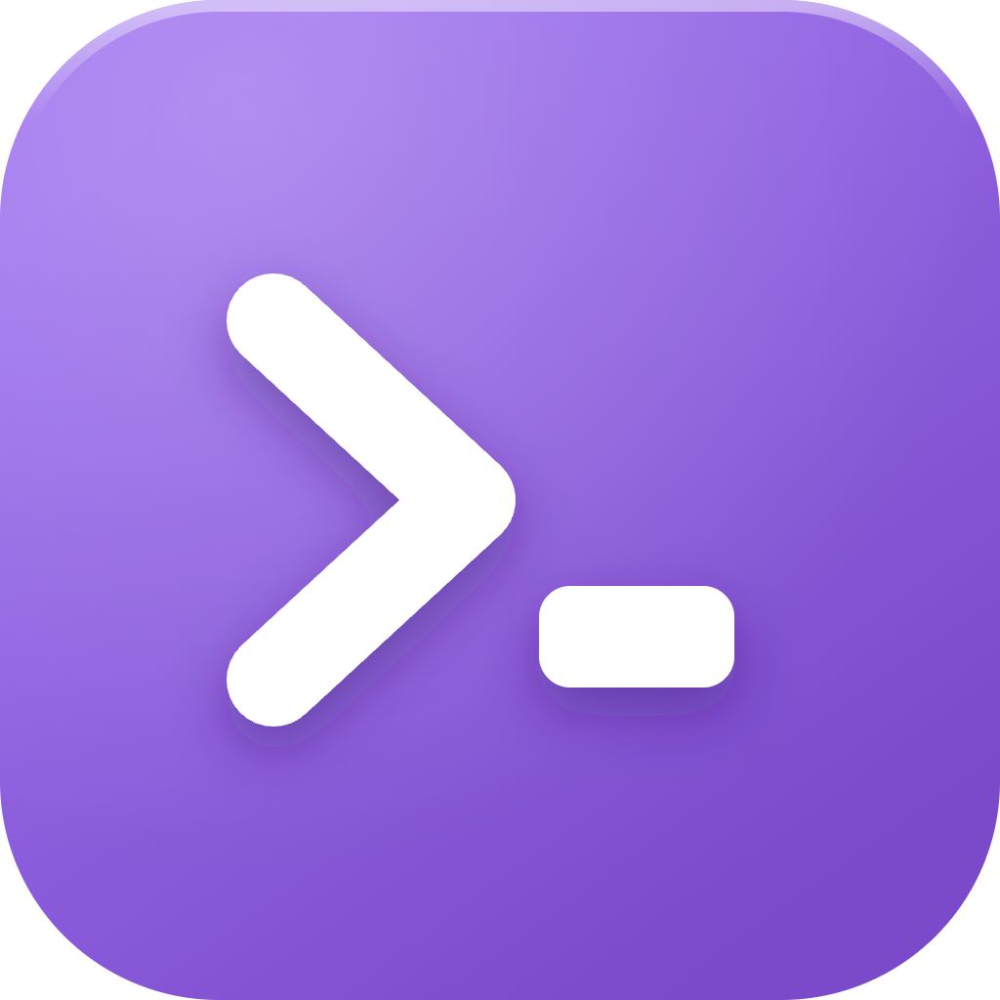

<div align="center">



# Tsubasa Terminal

**AI 运维助手内置的 Windows SSH 客户端——除了只读命令，都需要你过一遍**

[](https://github.com/AoShizuku/TsubasaTerminal/actions/workflows/ci.yml)
[](LICENSE)


</div>

> An Electron SSH client for Windows with a built-in AI ops assistant. Commands proposed by the
> AI pass a hard-coded gate (read-only whitelist runs automatically, everything else needs your
> approval), credentials never leave the main process, and external agents such as Claude Code
> or Codex can reuse your open sessions through the `tsubasa-ssh` CLI. The UI is in Chinese.

Tsubasa Terminal 把终端、SFTP 文件管理和 AI 运维助手放进同一个会话。
AI 能看到你看到的屏幕和命令历史，能提出并执行命令——但执行权始终在代码闸门和你手里。

## 为什么用它

- **闸门由代码硬判，不由模型决定。** 命令先经纯函数解析：只读白名单内的自动执行，
  其余一律转到审批台由你决定；模型无权降低任何规则的风险等级。
- **机密不出主进程。** 保存的 SSH 凭据与模型 API Key 只在主进程解密，渲染进程和
  模型都看不到；远端输出进入模型前按设置脱敏。
- **AI 和你共用同一个终端。** Agent 的命令写进你看得见的终端，读屏、结构化转录与
  shell integration 让它理解当前状态，而不是另开一条看不见的通道。
- **外部 Agent 也能接入。** `tsubasa-ssh` CLI 让 Claude Code、Codex 等复用已连接会话，
  共享同一套闸门、审批与审计；默认关闭，需在设置中手动启用。
- **经验可沉淀。** 排障经验与主机知识由 Agent 起草、经你确认后保存，下次对话按需读取。

## 功能

- **多会话终端**：主机管理、密码或私钥认证、主机指纹 TOFU 校验、多标签并行；
  固定命令输入栏与原生终端输入可切换，命令历史、Tab 补全、多套明暗配色。
- **文件管理**：SFTP 平铺与树形浏览、跟随终端目录、上传下载、trzsz / ZMODEM 转 SFTP；
  可按主机启用登录后提权，终端、独立命令与文件通道身份一致。
- **AI 运维助手**：自配模型服务与 API Key，支持 Anthropic、OpenAI Chat Completions
  与 Responses 协议；读屏、转录上下文、独立命令排障，变更经审批台执行。
- **对话与知识**：对话持久化、接续与迁移、Markdown 导出；全局与本机知识、排障经验。
- **外部 CLI**：`tsubasa-ssh` 提供主机清单、命令执行、多机并行与文件上传，并自动为
  Claude Code / Codex 安装 skill。

## 安装

从 [Releases](https://github.com/AoShizuku/TsubasaTerminal/releases) 下载
`tsubasaterminal-<版本>-setup.exe` 安装。系统要求 Windows 10 / 11（x64）。

> 安装包尚未代码签名，首次运行时 Windows SmartScreen 会提示“已保护你的电脑”，
> 点击“更多信息 → 仍要运行”即可。也可以按下文从源码构建。

## 快速上手

1. 左栏添加主机（或从 `~/.ssh/config` 导入），双击连接，首次连接确认主机指纹。
2. 标题栏齿轮 → 设置 →「模型服务」：填入服务地址与 API Key。
3. 在右栏 Agent 面板描述问题，例如“看看 nginx 为什么 502”。只读命令会自动执行，
   其余命令以审批卡出现在输入栏上方：`y` / `n` + `Ctrl+Enter` 批准或拒绝，
   直接打字留言则让它改方案。

完整用法、模型配置、CLI 与快捷键见 [用户指南](doc/user-guide.md)。

## 安全模型

| 边界 | 做法 |
| --- | --- |
| 凭据 | `safeStorage` 加密落盘，只在主进程解密；连接按 hostId 发起，渲染进程只见脱敏配置 |
| 命令执行 | 白名单为纯函数硬解析、fail-closed；非白名单命令需人工审批，模型不能降级规则 |
| 终端写入 | 终端未上报可写状态即不可写，自动化写入有最后一跳守卫 |
| 模型输入 | 远端输出净化与可配置脱敏，提示注入内容按数据处理 |
| 持久知识 | Agent 只能起草，落盘、修改、删除都须人确认 |
| CLI | 默认关闭；命名管道按“同用户即同权”设计，启用即向本机同用户进程开放控制入口 |

详见 [安全设计](doc/security-design.md) 与 [CLI 设计](doc/cli-bridge-design.md)。
发现安全问题请按 [SECURITY.md](SECURITY.md) 私下报告。

## 从源码构建

需要 Node.js 22 与 Windows（开发与 e2e 依赖 Windows 命名管道）。

```bash
npm ci
npm run build:cli   # 首次使用 CLI 前构建；dev 不含 CLI 产物
npm run dev         # 开发模式，热更新
npm run build:win   # 打包 Windows NSIS 安装包到 dist/
```

技术栈：Electron · electron-vite · Vue 3 · TypeScript · Tailwind CSS v4 · reka-ui · xterm.js · ssh2。
测试、真机 smoke 与发布流程见 [开发手册](doc/development.md)。

## 参与贡献

欢迎 Issue 与 PR，提交前请阅读 [CONTRIBUTING.md](CONTRIBUTING.md)。
模块职责与关键合约见 [技术架构](doc/architecture.md)，各专题设计见 [文档索引](doc/README.md)。

## 许可

[MIT](LICENSE) © AoShizuku。第三方依赖许可见 [THIRD_PARTY_NOTICES.md](THIRD_PARTY_NOTICES.md)。
